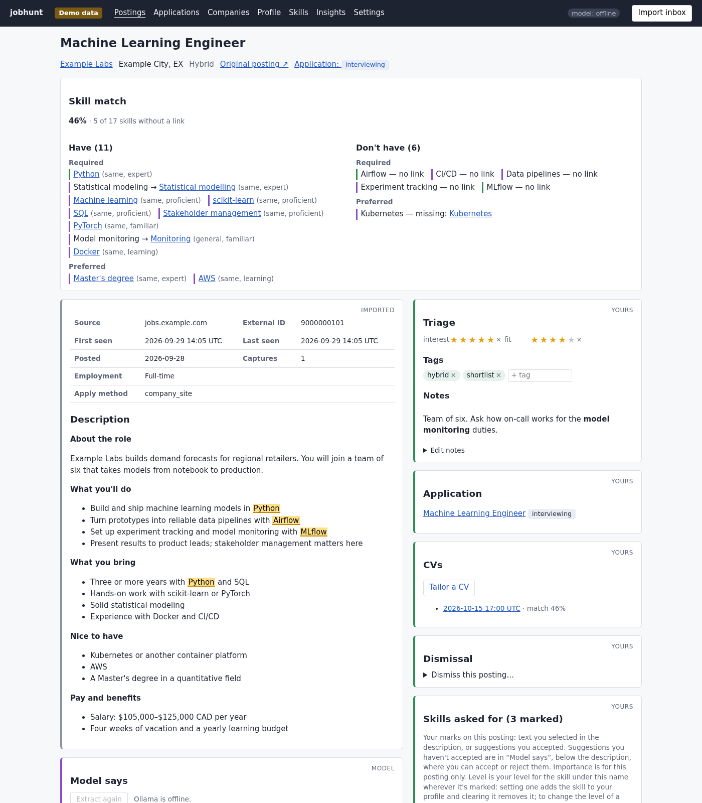
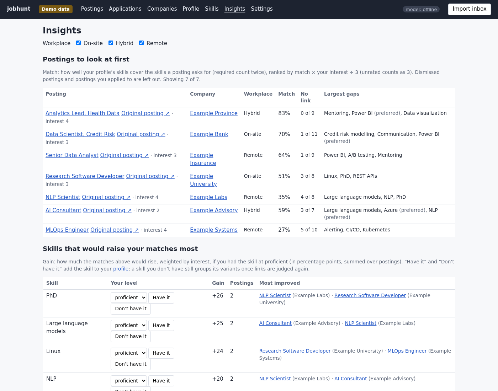
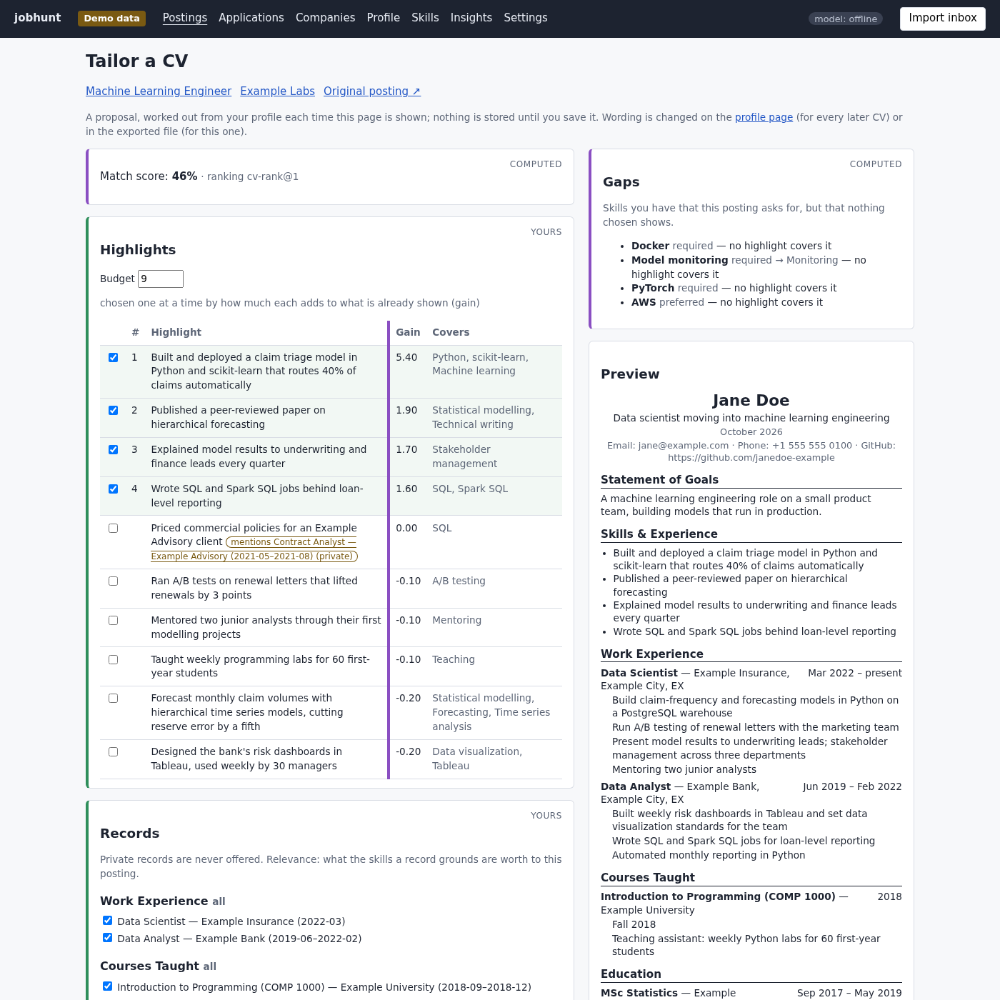

# jobhunt

A local-first job search tool. It keeps a searchable, annotated record of the job postings you collect. It matches
them against a structured CV with local models, and tailors a CV for any posting. Your postings, notes and profile
stay in a database on your machine, and model requests go only to a local [Ollama](https://ollama.com) server.



## Quick start

Requires Python 3.11 or later. Clone the repository, then, from its folder:

```bash
python3 -m venv venv
source venv/bin/activate
pip install -e .

jobhunt demo                      # a fictional person's job search, built offline
jobhunt serve --db sqlite:///demo/jobhunt.db --documents demo/documents
```

Open <http://127.0.0.1:8000/>. The demo shows every page with invented data (a "Demo data" label sits in the
header). It needs no model server: its model output comes from scripted answers run through the real pipeline.

For your own job search, run `jobhunt serve` with no options: it keeps its data in `data/` and imports from
`inbox/`. Model features need [Ollama](https://ollama.com) running locally, with a chat model and an embedding
model (such as `nomic-embed-text`) pulled; choose them on the Settings page. Everything else works without it.

## Features

- **Postings over time.** Import postings from files; every capture is kept, and a changed posting gets a new
  snapshot you can diff against the old one. Search, filter and sort; every posting links to its original.
- **Your own notes.** Interest and fit ratings, tags, Markdown notes, dismissals with reasons, and the skills a
  posting asks for, marked in its text.
- **Applications.** A board of applications with dated events, next actions, documents, companies and contacts.
- **Model suggestions.** A local model labels a posting's lines, lists the skills it asks for and reads its salary
  range. Every quote is checked against the text, and nothing is used until you accept it.
- **A structured profile.** Your experience as records (roles, courses, projects, publications, degrees and more),
  skills with levels and the records that show them, and CV highlights. A CV document can be read in as suggestions
  to accept or reject.
- **Skill links and recommendations.** Posting skills are linked to your profile skills (same, more specific, more
  general, related). Each posting gets a match score, and Insights ranks postings and the skills that would raise
  your matches most.
- **Tailored CVs.** For any posting, a CV proposal picks the highlights and records that cover what it asks for,
  lists the gaps, and never prints a record marked private. Save a frozen copy and export it as ODT.





## Design decisions

- **A person collects postings.** There is no crawler and nothing runs on a schedule. Postings come from files a
  person saves and imports, and the importer never works around a site's limits.
- **Captured, user-authored and derived data are kept apart, with one writer each.** Re-importing a posting can't
  change your notes, and a model run can't change anything you wrote. Captured history is appended, never
  rewritten. See [docs/architecture.md](docs/architecture.md).
- **Model output is a suggestion, checked against the text.** Steps work on character offsets into the stored
  description, so they can label text but not rewrite it. A quote that isn't in the text can't be accepted.
- **Local models only.** One configurable Ollama address, fixed at startup and never taken from the browser.
- **Portable SQL.** SQLAlchemy Core on SQLite and Postgres. Every storage test runs on both, and a test fails if
  the migrated schema differs from the table definitions.
- **Decisions are written down first.** Each feature went through an [OpenSpec](https://github.com/Fission-AI/OpenSpec)
  change: a proposal, a design with its alternatives, and the spec it changed. They are all in
  [`openspec/changes/archive/`](openspec/changes/archive/).

## Measuring the models

Prompts and linking methods are measured against the user's own labels before they replace what the app uses:

- labelled postings, each drawn at random into a dev set or a holdout set the prompts were never tuned on;
- recall against the marks the user found unaided;
- a paired sign test that says `within noise` unless a difference is unlikely by chance.

Several plausible improvements were measured and not adopted. [docs/measurement.md](docs/measurement.md) has the
method and the results.

## Known limitations

- The labelled sets are small, so most differences between prompts are within noise.
- Linking by bare skill names misses concept-to-tool links (a technique to a specific library). Expanding names
  finds them but breaks correct "no link" answers.
- The link judge is stricter than a person on "general" and "related", and the shortlist threshold was tuned on
  one profile.
- A "no link" answer isn't flagged for review when the profile later gains a candidate.
- Reading a CV document still suggests near-duplicate skills and fragments, which you reject or merge once.
- There is no authentication. The web interface listens on `127.0.0.1` and checks the Host header and the origin
  of every request that changes data (see [SECURITY.md](SECURITY.md)).

## Getting postings in

Put files in `inbox/` and run `jobhunt import`, or press "Import inbox" in the web interface. Every installed
parser is tried on every file. A file is imported only when exactly one parser accepts it, and otherwise set aside
with the reason. Files move to `inbox/processed/` or `inbox/rejected/`; the import deletes nothing.

A parser can mark some of a file's companions as discardable, such as the asset folder a browser saves beside a
page. While `jobhunt serve` runs, it deletes those from `inbox/processed/` and `inbox/rejected/` once a day and keeps
everything else: the files themselves, their download metadata and every other companion. The first `serve` after
upgrading deletes the folders already there; `jobhunt inbox prune --dry-run` lists them (with sizes) first, and
`jobhunt inbox prune` prunes by hand. Deleted companions can't be restored, so back up `inbox/` first if you want
them.

The built-in parser reads **posting files**: one JSON object per posting.

```json
{
  "format": "jobhunt-posting",
  "version": 1,
  "source": "jobs.example.com",
  "external_id": "9000000101",
  "url": "https://jobs.example.com/view/9000000101",
  "title": "Machine Learning Engineer",
  "company": "Example Labs",
  "description_html": "<p>What you'll do</p><ul><li>Build models in Python</li></ul>",
  "location": "Example City, EX",
  "workplace_type": "Hybrid",
  "posted_on": "2026-09-28"
}
```

`source`, `external_id`, `url`, `title`, `company` and `description_html` are required. A posting's identity is
its source and external ID, never the filename. Descriptions are sanitized when imported.
[`src/jobhunt/demo/postings/`](src/jobhunt/demo/postings/) has complete examples, and
[`openspec/specs/capture-import/`](openspec/specs/capture-import/spec.md) has every field.

**Other formats** are read by parser plug-ins: any installed package can register one under the `jobhunt.parsers`
entry-point group. A parser recognises the files it reads by their contents and returns a parsed posting or a
reason for rejecting it. [docs/parsers.md](docs/parsers.md) is the guide to writing one, with its contract changelog.

## Development

```bash
pip install -e ".[dev,postgres]"
pytest                                                          # SQLite
JOBHUNT_TEST_PG_URL=postgresql+psycopg:///jobhunt_test pytest   # also Postgres
ruff check
pre-commit install                                              # privacy check and ruff on each commit
```

[CLAUDE.md](CLAUDE.md) is the working guide to the code, for contributors and coding agents alike: commands,
architecture and conventions. [ROADMAP.md](ROADMAP.md) lists planned work. Every person, company and posting in
the tests, specs and demo is invented ([docs/fictional-data.md](docs/fictional-data.md)). `jobhunt privacy-check`
keeps it that way by scanning commits for values from your own database.

## How this was built

jobhunt was built with [Claude Code](https://claude.com/claude-code), one OpenSpec change at a time. The author
set the requirements and constraints, labelled the data, ran and judged every measurement, chose what to keep,
and reviewed the code. The model drafted most of the code, tests and spec text. The design record in
[`openspec/changes/archive/`](openspec/changes/archive/) shows each decision with its alternatives. The
measurement write-ups show which proposals the numbers didn't support, and which were dropped as a result.

## License

[MIT](LICENSE)
