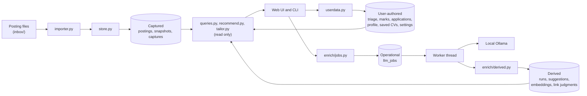

# Architecture

jobhunt is one Python package (`src/jobhunt/`) with a command line, a server-rendered web interface and a single
background worker. It stores everything in one database (SQLite by default, Postgres optionally) plus a folder of
uploaded documents. The design record behind each part is in [`openspec/`](../openspec/): accepted behaviour in
`openspec/specs/`, and the changes that built it, with their reasons, in `openspec/changes/archive/`.

## Four kinds of data, one writer each

Every table belongs to one kind, and each kind has exactly one module that writes it. That rule is what keeps a
re-import from touching your notes, and a model run from changing anything you wrote.



| Kind | Tables (examples) | Only writer | Rules |
|---|---|---|---|
| Captured | `postings`, `posting_snapshots`, `captures` | `store.py`, through the importer | History is appended, never rewritten. A new snapshot is stored only when the posting's content changes. The original file is kept. |
| User-authored | triage, skill marks, applications, documents, the profile, saved CVs, settings | `userdata.py` | Import, re-import and model runs never touch it. |
| Derived | posting runs and their suggestions, document runs, embeddings, link judgments | `enrich/derived.py` | A run is never edited; running again adds one. Model output is a suggestion until you accept it. |
| Operational | `llm_jobs` | `enrich/jobs.py` | The work queue for the worker. |
| Operational | `inbox_prunes` | `prune.py` | A record of each prune of the inbox; rows are appended. |

The web interface marks each kind visually (`.src-captured`, `.src-user`, `.src-derived`), so you can always tell
what came from a posting, what you wrote and what a model suggested.

## Modules

```
src/jobhunt/
    cli.py            import, inbox prune, serve, eval, profile reset, privacy-check, demo
    parsers/          the parser plug-in protocol and the built-in posting-file parser
    sanitize.py       description HTML -> allowlisted HTML and plain text
    importer.py       every installed parser on every inbox file; one transaction per file
    prune.py          deletes discardable companions of filed-away files; the daily Pruner thread
    store.py          the only writer of captured data
    userdata.py       the only writer of user-authored data
    queries.py        read models for every page (no Flask)
    recommend.py      match scores, posting ranking, skill pools and gains (computed on each view)
    tailor.py         a CV proposal for a posting (computed on each view)
    cvdoc/            CV layout and ODT export
    documents.py      content-addressed document store and text extraction (PDF, DOCX, ODT, TXT, MD)
    db.py, migrate.py, migrations/   tables, engine setup, Alembic revisions
    privacy.py        the release privacy check
    demo/             the demo's persona, postings, scripted model and seed
    enrich/
        ollama.py     the Ollama HTTP client (standard library only)
        pipeline.py   step protocols, pipeline ids, running a posting through its steps
        segment.py, skills.py, salary.py, validate.py   the posting steps and the quote checks
        cv.py, terms.py   reading a CV document into profile suggestions
        links.py, expand.py   linking posting skills to profile skills
        evaluate.py, link_eval.py   measurement against your labels and links
        derived.py    the only writer of derived data
        jobs.py       the queue and the worker thread
    web/              Flask blueprints, request guard, Jinja templates, vendored htmx
```

Route handlers stay thin: logic lives in `userdata.py`, `queries.py`, `recommend.py`, `tailor.py` and
`documents.py`, which are tested without Flask.

## Models

Models run on a local [Ollama](https://ollama.com) server only; no data leaves the machine. Every request uses
temperature 0, a fixed seed and a JSON schema. Text positions are character offsets into the stored description, so
a step can label text but never rewrite it. Every quote the model returns is checked against the text, and an
unverified item is stored for inspection but can't be accepted.

Each step has a name and version (`atomic@2`, `link-judge@5`), and a run records the pipeline id it used. A step
whose output changes gets a new version, so old and new runs are never compared as equal. The app uses one method
per step, named in code. A candidate version sits beside it only while it is being measured, and is deleted if it
isn't adopted (see [measurement.md](measurement.md)).

## Storage

SQLAlchemy Core (no ORM) keeps the SQL portable between SQLite and Postgres, and every storage test runs on both.
The schema changes only through Alembic revisions, which every `import` and `serve` applies. A test fails if the
migrated schema differs from the table definitions.

## Collection

Postings arrive as files a person collects. Parsers are installed plug-ins (the `jobhunt.parsers` entry-point
group). The importer tries every parser on every file, and a file is imported only when exactly one accepts it. A
posting's identity is its source and external ID, never its filename. There is no crawler and no scheduled
collection: a person starts every import. The import deletes nothing; the only deletion is the prune, which removes
the companions a parser marks discardable once their file is in `processed/` or `rejected/`. Writing a parser:
[parsers.md](parsers.md).
